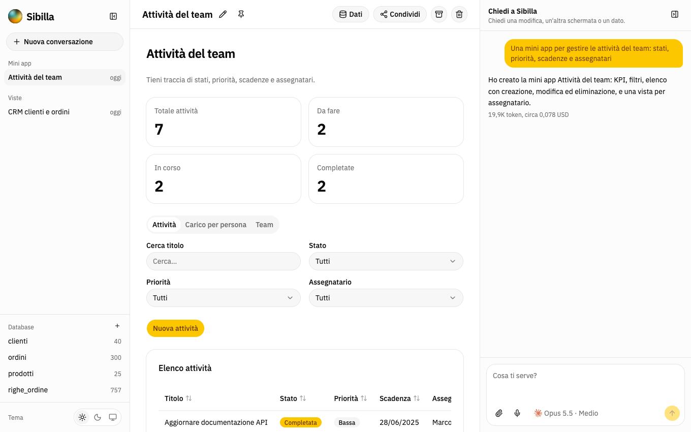
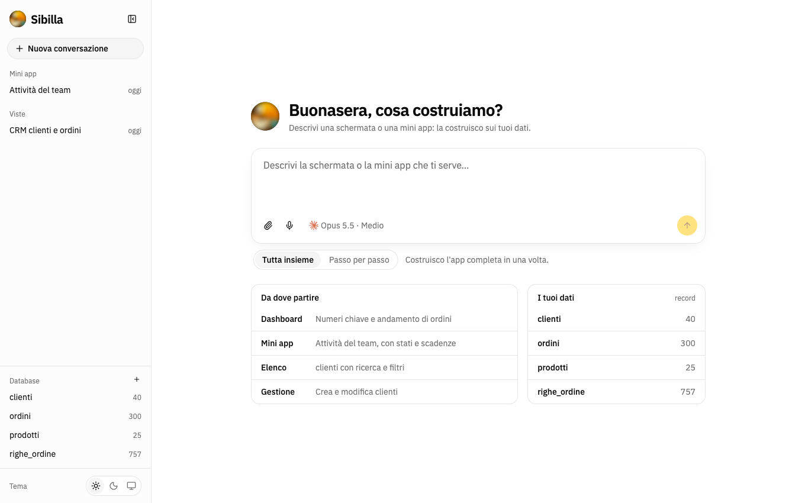
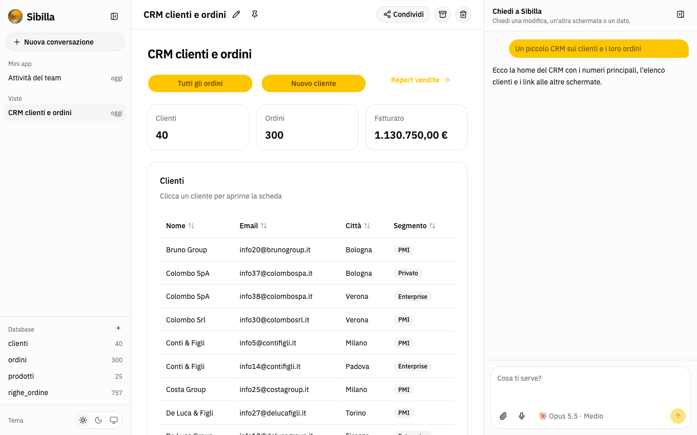
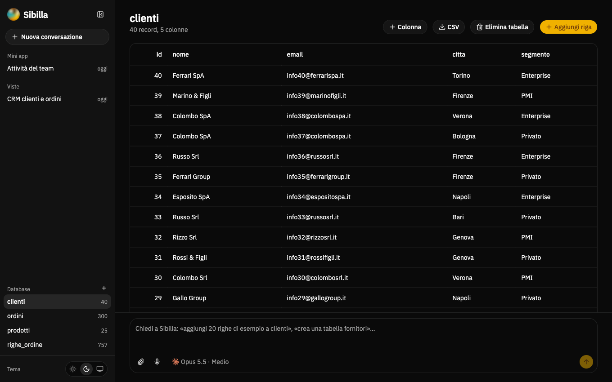

<p align="center">
  
</p>

<h1 align="center">Sibilla</h1>

<p align="center"><strong>Descrivi l'interfaccia o la mini app che ti serve; un modello la costruisce sui tuoi dati.</strong></p>



Sibilla è una webapp generativa. Scrivi in chat (o detta, o allega uno screenshot) cosa vuoi vedere: una dashboard, un elenco con filtri, un piccolo gestionale. Il modello esplora i dati, scrive una descrizione dell'interfaccia in JSON e Sibilla la disegna con componenti già pronti, collegata ai dati veri. Se i dati non esistono ancora, li crea.

> *Sibilla is a generative web app: describe the screen or mini app you need and an LLM (Claude, GPT or Gemini) builds it on your data. Documentation is in Italian.*

## Cosa fa

- **Viste sui dati**: KPI, grafici, tabelle, filtri, form di creazione e modifica, costruiti su tabelle SQL esistenti.
- **Mini app con i propri dati**: quando serve qualcosa che il database non copre, il modello dichiara le collezioni di documenti necessarie e il backend è già pronto (lettura, scrittura, validazione).
- **Due modi di costruire**: tutta l'app in una volta, oppure passo per passo, generando ogni schermata la prima volta che ci entri e conservandola.
- **Database gestibile dall'app e dalla chat**: crea tabelle, colonne e righe da una schermata dedicata, o chiedilo a parole.
- **Più modelli**: Claude, ChatGPT e Gemini, con scelta di modello e impegno, ragionamento visibile, stima dei costi.
- **Tutto salvato**: conversazioni, versioni di ogni interfaccia, ripristino; link pubblico per far usare una mini app a chi non ha Sibilla.
- **Viste libere**: quando i componenti non bastano, il modello scrive un componente React con qualsiasi libreria npm, eseguito in una sandbox.

## Anteprima

| | |
| --- | --- |
|  |  |
| **Nuova conversazione.** Scrivi cosa ti serve, scegli se costruirla tutta insieme o passo per passo, parti dai tuoi dati. | **Una vista.** KPI, tabelle e link verso altre schermate, costruiti sulle tabelle del database. |
|  |  |
| **Una mini app.** Sibilla ha creato anche le collezioni in cui l'app salva i suoi dati. | **Database.** Tabelle, righe e colonne si gestiscono dall'app o chiedendolo in chat. |

## Avvio rapido

Serve [Node.js](https://nodejs.org) 24 o successivo.

```bash
git clone https://github.com/Kasketto001/sibilla.git && cd sibilla
npm install
npm run dev
```

Apri <http://localhost:5173>. Al primo avvio:

1. crea il tuo account (email e password);
2. dal pulsante del modello nella casella di scrittura apri **Accesso ai modelli** e incolla la chiave API di almeno un fornitore (in alternativa mettila in `server/.env`, vedi `server/.env.example`);
3. scrivi cosa ti serve.

Il database SQLite (`server/sibilla.db`) nasce con dati dimostrativi: clienti, prodotti, ordini.

Per usarla in produzione su una sola porta:

```bash
npm run build   # compila l'interfaccia
npm start       # serve API e interfaccia su http://localhost:8787
```

## Documentazione

La cartella [`docs/`](docs/Home.md) è la base di conoscenza del progetto, leggibile qui o aperta come vault in [Obsidian](https://obsidian.md) (*Apri cartella come vault* → `docs`).

| Per | Leggi |
| --- | --- |
| Installare e configurare | [Installazione](docs/Guida/Installazione.md), [Configurazione](docs/Guida/Configurazione.md) |
| Usarla | [Uso](docs/Guida/Uso.md) |
| Capire come funziona | [Panoramica](docs/Architettura/Panoramica.md), [Spec](docs/Architettura/Spec.md), [Generazione](docs/Architettura/Generazione.md), [Dati](docs/Architettura/Dati.md) |
| Valutarne la sicurezza | [Sicurezza](docs/Architettura/Sicurezza.md), [SECURITY.md](SECURITY.md) |
| Contribuire | [CONTRIBUTING.md](CONTRIBUTING.md), [Codice](docs/Sviluppo/Codice.md), [Test](docs/Sviluppo/Test.md) |
| Sapere cosa manca | [Limiti](docs/Sviluppo/Limiti.md) |

## Comandi

| Comando | Cosa fa |
| --- | --- |
| `npm run dev` | API (porta 8787) e interfaccia (porta 5173) in sviluppo |
| `npm test` | Tutti i test |
| `npm run typecheck` | Controllo dei tipi su `shared`, `server` e `web` |
| `npm run lint` | Lint dell'interfaccia |
| `npm run build` / `npm start` | Compila l'interfaccia e avvia il server che serve tutto |

## Stato del progetto

Sibilla è un progetto giovane, nato come prova di concetto. Funziona, ma leggi [Limiti](docs/Sviluppo/Limiti.md) e [Sicurezza](docs/Architettura/Sicurezza.md) prima di esporla su una rete che non controlli: usa SQLite su file, le tabelle del database sono comuni a tutti gli utenti, e le viste libere eseguono codice scritto dal modello (in una sandbox del browser).

## Licenza

[MIT](LICENSE). I marchi di Claude, OpenAI e Gemini mostrati nel selettore dei modelli appartengono ai rispettivi proprietari; i tracciati vengono da [Simple Icons](https://simpleicons.org).
